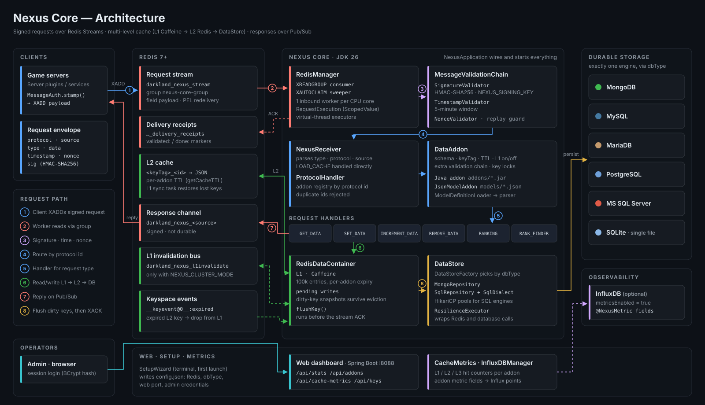
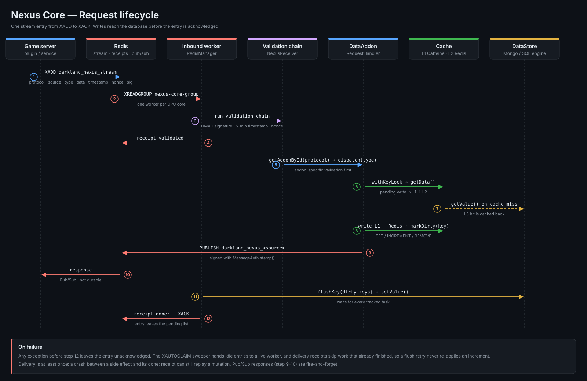

# Architecture

How Nexus Core moves a request from a game server to the database and back. This page follows the source under `src/main/java/network/darkland`.

## At a glance

Clients never talk to the database. They append signed requests to one Redis Stream, and Nexus Core is the only process that reads it. Core answers through a Redis Pub/Sub channel named after the requesting server.

Data is read through three tiers:

| Tier | Where | Lifetime |
| --- | --- | --- |
| **L1** | Caffeine, in the Core JVM (`RedisDataContainer`) | Per-addon TTL, at most 100,000 entries. An addon can switch L1 off. |
| **L2** | Redis keys `<cacheKeyHeaderTag>_<id>` | Per-addon TTL (`getCacheTTL`) |
| **L3** | The configured `DataStore`: MongoDB, MySQL, MariaDB, PostgreSQL, MSSQL, or SQLite | Durable |

## Components

| Package | Main types | Responsibility |
| --- | --- | --- |
| `network.darkland` | `NexusApplication` | Reads `config.json`, builds every manager, loads addons and JSON models, starts the stream consumer and the web server. |
| `redis` | `RedisManager`, `NexusReceiver`, `RequestExecution`, `RedisDataContainer`, `MessageAuth` | Stream consumption, delivery receipts and ACK, request parsing, L1 cache and pending writes, response signing. |
| `redis.security` | `MessageValidationChain`, `SignatureValidator`, `TimestampValidator`, `NonceValidator`, `HmacSigner` | Rejects unsigned, stale, or replayed messages. |
| `protocol` | `ProtocolHandler`, `DataAddon`, `RequestType`, `RequestHandler` | Addon registry keyed by protocol id. Maps each request type to a handler. |
| `protocol.handlers` | `Get`, `Set`, `Increment`, `Remove`, `Ranking`, `RankFinder` handlers | Built-in behavior for each request type. |
| `model`, `model.schema` | `DataModel`, `JsonModelAddon`, `ModelDefinitionLoader`, `ModelSchemaParser` | Cached values, plus addons defined as JSON in `models/`. |
| `cache` | `CacheMetrics`, `L1InvalidationBus` | L1/L2/L3 hit counters and cross-instance L1 eviction. |
| `db`, `db.mongo`, `db.sql.*` | `DataStore`, `DataStoreFactory`, `MongoRepository`, `SqlRepository`, `SqlDialect` | One storage interface. Each SQL engine adds a dialect; SQL engines use HikariCP pools. |
| `resilience` | `ResilienceConfig`, `ResilienceExecutor` | Resilience4j retry and circuit breaker around Redis and database calls. |
| `Influxdb` | `InfluxDBManager`, `@NexusMetric` | Optional export of addon fields as InfluxDB points. |
| `web` | `WebApplication`, `SecurityConfig`, `*Controller`, `SetupWizard` | Spring Boot dashboard and REST API, plus the first-launch terminal wizard. |

## Request lifecycle

1. **Publish.** A client stamps the request with `MessageAuth.stamp()` and runs `XADD darkland_nexus_stream * payload <json>`.
2. **Consume.** `RedisManager` reads with `XREADGROUP` as part of the `nexus-core-group` consumer group and queues the entry. Core starts one inbound worker per CPU core.
3. **Validate.** `NexusReceiver` runs the validation chain: an HMAC-SHA256 signature using `NEXUS_SIGNING_KEY`, a five-minute timestamp window, and a nonce check against replays. A passing entry gets a `validated:` delivery receipt.
4. **Route.** `ProtocolHandler.getAddonById(protocol)` finds the addon. The addon's own validation chain runs, then `handleRequest` can veto the request. After that, `dispatch(type)` calls the registered `RequestHandler`. `LOAD_CACHE` skips this step and calls `loadIntoCache(key)` directly.
5. **Read.** Each handler runs under a per-key lock (`withKeyLock`). `DataAddon.getData()` checks, in order: the pending-write buffer, L1, L2, then `DataStore.getValue()`. An L2 or L3 hit is written back into the cache tiers.
6. **Write.** A mutation updates L1 and Redis and calls `markDirty(key)`. The dirty key is recorded on the current `RequestExecution`, which is bound with a Java 26 `ScopedValue`.
7. **Reply.** For `GET_DATA` and the ranking requests, the handler publishes a signed response on `darkland_nexus_<source>`.
8. **Flush, then acknowledge.** The worker waits for every task tracked by the request. It then calls `flushKey()` on each dirty key, writes a `done:` receipt, and runs `XACK`.

### Delivery guarantees

- **At least once.** If a step throws, the entry stays in the pending entries list. The `XAUTOCLAIM` sweeper gives idle entries to a live worker.
- **No double increments on flush retries.** Once a request's handlers have finished, its dirty-key set is kept. A failed flush retries only the flush, not the handlers.
- **Possible replays after a crash.** A crash between a side effect and its `done:` receipt can still replay a mutation. Custom addon side effects should be idempotent.
- **Responses are not durable.** Pub/Sub messages are lost if the client is not subscribed when they are sent.

## Caching details

| Mechanism | Trigger | Effect |
| --- | --- | --- |
| Per-addon expiry | Caffeine `expireAfter` | L1 entries live as long as the addon's `getCacheTTL()` says. |
| Keyspace events | `__keyevent@0__:expired` | When a Redis key expires, Core drops the same key from L1. |
| L1 sync task | Every 10 s | Copies newer Redis values into L1. If a key is missing from Redis, Core restores it and marks it dirty. |
| Auto-flush | Every 15 s | Writes any remaining dirty keys to the `DataStore`, such as writes made outside a stream request. |
| Reconciliation | Every 3 min | Compares clean L1 entries with the database and repairs any differences. Entries with newer mutations are skipped. |
| Cluster invalidation | `NEXUS_CLUSTER_MODE=true` | A write publishes `<nodeId>\|<key>` on `darkland_nexus_l1invalidate`. Other Core instances evict that key from L1. |

Pending-write snapshots are separate from L1. If an entry is evicted from L1 before it is flushed, its write is still kept.

## Addons and models

A `DataAddon` defines a protocol id, a name, a cache key prefix (`cacheKeyHeaderTag`), a namespace and dataset (a database or collection, or a table), a TTL, and an optional L1 switch. There are two ways to provide one:

- **Java addons.** At startup, JAR files in `addons/` are loaded with a `URLClassLoader`.
- **JSON models.** `ModelDefinitionLoader` reads `models/*.json` and registers a `JsonModelAddon` for each file, so no compiling is needed.

`ProtocolHandler` rejects duplicate protocol ids. An addon can register extra `RequestType`s and handlers alongside the six defaults.

## Security

- **Messages.** HMAC-SHA256 signatures, a five-minute timestamp window, and single-use nonces. Unsigned messages are rejected unless `NEXUS_ALLOW_UNSIGNED_MESSAGES=true`.
- **Responses.** Signed with the same key, so clients can verify that a response came from Core.
- **Dashboard.** Spring Security with session login and a BCrypt (cost 12) admin password from `config.json`. CSRF protection uses cookie tokens.

## Web dashboard and metrics

The dashboard runs on Spring Boot, on port `8088` by default, with virtual threads enabled. Its main endpoints:

| Endpoint | Purpose |
| --- | --- |
| `POST /api/login`, `/api/logout` | Session authentication |
| `GET /api/stats`, `/api/stream/stats` (SSE) | Runtime statistics and a live stream of them |
| `GET /api/addons`, `/api/addons/csv` | Registered addons |
| `GET /api/cache-metrics`, `/api/cache-metrics/csv` | L1/L2/L3 hits per addon |
| `GET /api/addons/{addonId}/keys`, `/api/keys/value` | Browse cached keys and their values |
| `GET /api/health` | Health check |

When `metricsEnabled` is true, `InfluxDBManager` writes fields annotated with `@NexusMetric` as InfluxDB points.

## Redis names reference

| Name | Type | Direction |
| --- | --- | --- |
| `darkland_nexus_stream` (field `payload`) | Stream, group `nexus-core-group` | Client → Core |
| `darkland_nexus_delivery_receipts` | Hash | Core-internal |
| `darkland_nexus_<source>` | Pub/Sub | Core → client |
| `darkland_nexus_live` | Pub/Sub, every 1 s | Core → all (`LIVE` heartbeat) |
| `darkland_nexus_l1invalidate` | Pub/Sub | Core ↔ Core (cluster mode) |
| `<cacheKeyHeaderTag>_<id>` | String (JSON) | L2 cache |

## Threading

- Inbound workers are platform threads, one per CPU core, that take entries from an in-memory queue.
- Handler work, outbound publishes, and database calls run on virtual-thread executors.
- `RequestExecution` counts tracked tasks, so a stream entry is acknowledged only after all of its nested work has finished.